# ZOOD Attendance: UniFi Access to Jisr

When an employee taps a badge, face or phone at a ZOOD door, this service turns that tap into an attendance punch in Jisr HR. It also gives HR and managers a bilingual (Arabic and English) dashboard for the company, each department and each person.

One Node process does everything:

- receives door events from UniFi Access;
- decides which taps count as attendance;
- sends those taps to Jisr in order and confirms each one;
- serves the dashboard.

It runs in Docker on the Synology NAS.

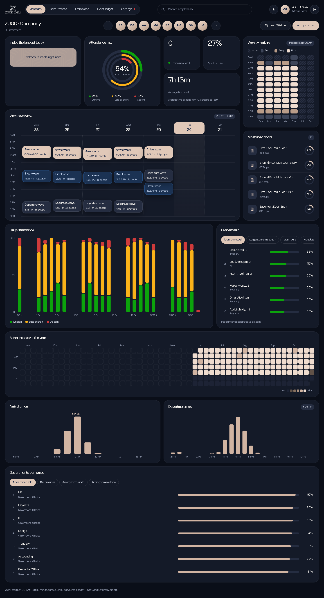

> All screenshots come from the local demo database, so every name and number in them is fictional. Arabic versions are in [`docs/screenshots/ar`](docs/screenshots/ar).

---

## Contents

- [How it works](#how-it-works)
- [The dashboard, page by page](#the-dashboard-page-by-page)
- [Attendance rules: green, yellow and red](#attendance-rules-green-yellow-and-red)
- [System health](#system-health)
- [Accounts and roles](#accounts-and-roles)
- [The employee list](#the-employee-list)
- [Safety rules for punches](#safety-rules-for-punches)
- [Running it](#running-it)
- [Deploying on the Synology NAS](#deploying-on-the-synology-nas)
- [Configuration](#configuration)
- [API](#api)
- [Project layout](#project-layout)
- [Tests](#tests)
- [Status and open items](#status-and-open-items)

---

## How it works

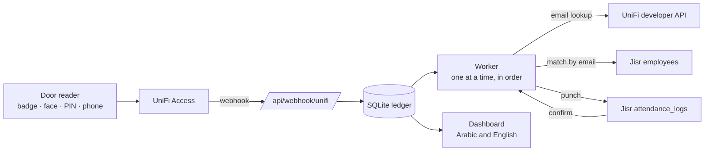

1. **Intake.** UniFi posts every door event to `POST /api/webhook/unifi`. The event is saved to SQLite before anything else happens, so nothing is lost if Jisr is down.
2. **Classify.** Badge (NFC), face, PIN, wallet and mobile taps count as attendance. Remote unlocks, doorbell calls, admin actions, emergency mode, failed taps, malformed events and events that are too old or in the future are kept in the ledger but never punched.
3. **Direction.** An entry reader means IN and an exit reader means OUT. A second IN without an OUT in between is skipped, and the same source event is never processed twice.
4. **Identify.** The person is matched to Jisr by email. If the UniFi event has no email, the service looks it up in the UniFi user directory. If it still can't find a single match, the event is held for HR.
5. **Send and confirm.** The worker sends one punch at a time for each employee. A punch is marked **confirmed** only after Jisr's attendance log shows it with the same employee and minute. If the network fails mid-send, the punch is checked against Jisr instead of being sent again.

---

## The dashboard, page by page

Every page is available in Arabic (right to left) and English; the **ع / EN** button in the top bar switches language. Every page has a date range: today, 7 days, 30 days, 90 days, this month, this year, or custom dates. The search box in the top bar finds any employee by name or email.

### Sign in

Staff accounts only. The session is an HttpOnly cookie, and repeated wrong passwords are blocked for 15 minutes.

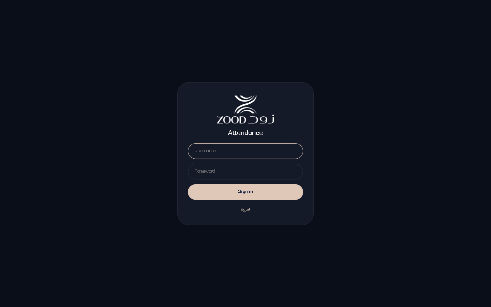

### Company

The whole company at a glance:

- **Attendance mix:** the share of days that were on time, late or short, and absent.
- **Live counts:** who is inside the building right now, the on-time rate, and the average time inside.
- **Inside the longest today.**
- **Weekly activity** heat map by hour, and **most used doors**.
- **Week overview:** typical arrival, break and leaving times for each day.
- **Daily attendance:** one stacked bar per day.
- **Leaderboard:** most punctual, longest on-time streak and most hours.
- **Attendance over the year:** a full year as a calendar grid.
- **Departments compared** on attendance, punctuality, time worked and time outside.
- **Arrival and departure time** distributions.
- **Upload list** button for the HR employee list (Excel).


### Departments

One card per department, with its function (Executive, Shared Services, Development, Finance). Each card shows the attendance rate, on-time rate, average time inside, typical arrival and how many people are in right now. Filter by function along the top.

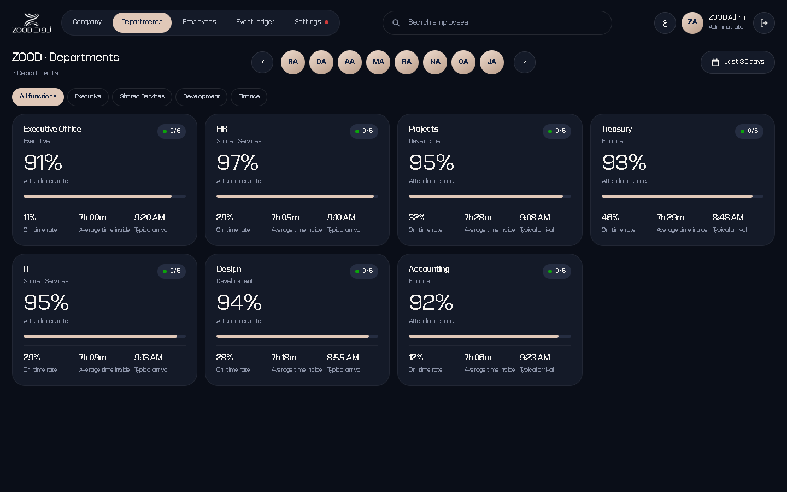

### Department

The same views as the Company page, limited to one team. This is the manager's view: who is in, who is late, and how the team compares over the month and the year. Arrival and departure times sit side by side, with the team's employee table across the full width below them.

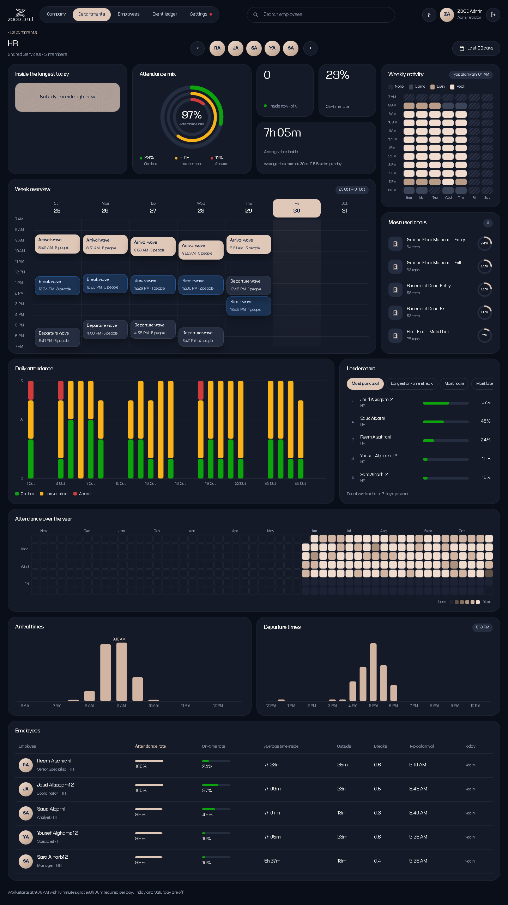

### Employees

Everyone on the HR list, with title and department. For the period it shows:

- attendance rate and on-time rate;
- average time inside, time outside and breaks per day;
- typical arrival;
- whether they are in today.

Search by name, or filter by department. Click a person to open their page.

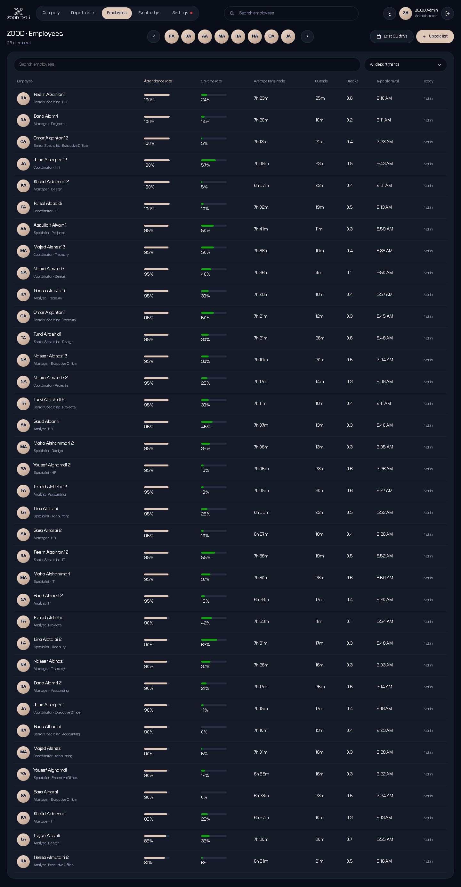

### Employee

One person in full:

- **Profile card:** name, title, department, employee number and office.
- **Time inside today**, with a live timer while they are in the building.
- **Attendance mix**, current and best **on-time streak**, and their **rank** in the department.
- **Average time inside**, and **time outside** (breaks per day).
- **Recent taps:** every IN and OUT with the door and the time.
- **Week overview:** blocks of time inside, per day.
- **Time inside and outside per day** against the required hours.
- **Arrival times** chart against the work start time.
- **Attendance over the year** calendar.
- **Day timeline:** each day's time inside, absences and total hours.
- **Most used doors.**

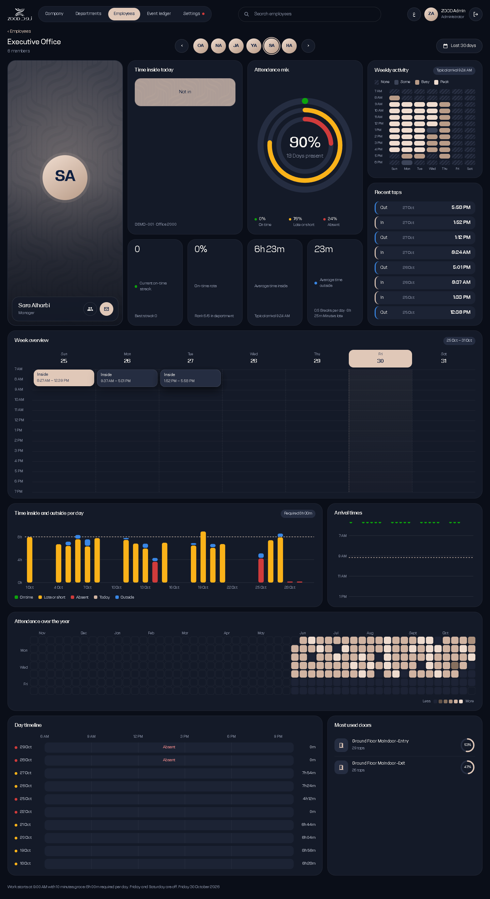

### Event ledger (admins)

Every UniFi delivery and what happened to it:

- **Status:** queued, held, sent, confirmed, skipped, duplicate, failed or unconfirmed.
- **Reason** for the status, and the Jisr response.
- **Actions:**
  - **Pause / resume** sending to Jisr.
  - **Retry** a single event.
  - **Map an email** to a held event; it then goes back through the normal queue.

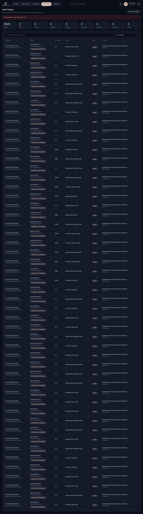

### Settings

- **System health:** see [below](#system-health).
- **Work rules** that HR can change without a deploy:
  - work start time;
  - late grace in minutes;
  - required hours per day;
  - weekend days.

  A live preview shows when an arrival starts to count as late. Every colour on every page follows these rules.
- **Holidays:** see [below](#holidays).

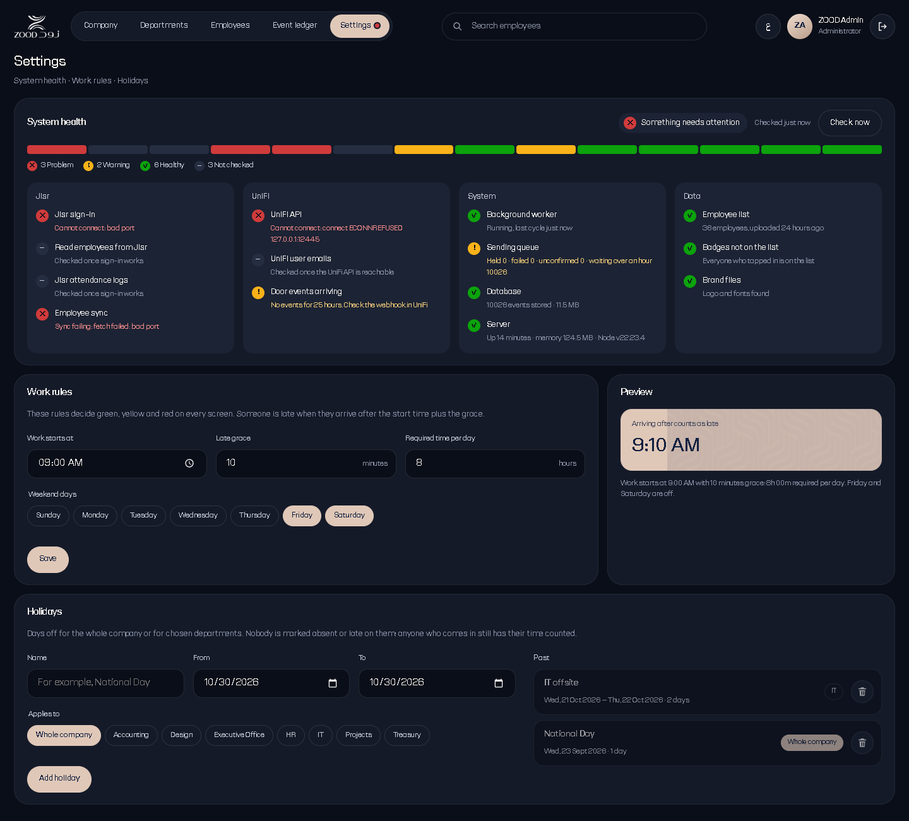

### On a phone

Every page reflows to a single column at phone width.

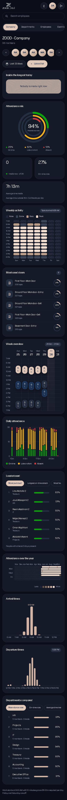 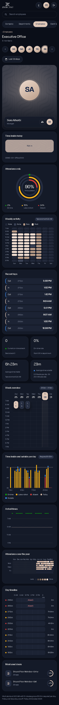

### Arabic

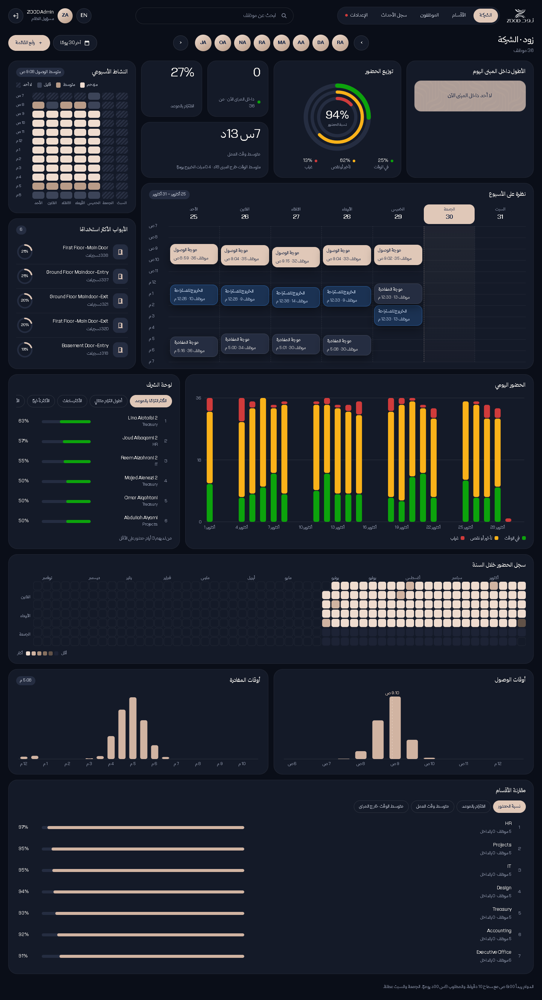

| Page | English | Arabic |
|---|---|---|
| Sign in | [en](docs/screenshots/en/01-login.png) | [ar](docs/screenshots/ar/01-login.png) |
| Company | [en](docs/screenshots/en/02-company.png) | [ar](docs/screenshots/ar/02-company.png) |
| Departments | [en](docs/screenshots/en/03-departments.png) | [ar](docs/screenshots/ar/03-departments.png) |
| Department | [en](docs/screenshots/en/04-department.png) | [ar](docs/screenshots/ar/04-department.png) |
| Employees | [en](docs/screenshots/en/05-employees.png) | [ar](docs/screenshots/ar/05-employees.png) |
| Employee | [en](docs/screenshots/en/06-employee.png) | [ar](docs/screenshots/ar/06-employee.png) |
| Event ledger | [en](docs/screenshots/en/07-events.png) | [ar](docs/screenshots/ar/07-events.png) |
| Settings | [en](docs/screenshots/en/08-settings.png) | [ar](docs/screenshots/ar/08-settings.png) |
| Phone: company | [en](docs/screenshots/en/09-phone-company.png) | [ar](docs/screenshots/ar/09-phone-company.png) |
| Phone: employee | [en](docs/screenshots/en/10-phone-employee.png) | [ar](docs/screenshots/ar/10-phone-employee.png) |

---

## Attendance rules: green, yellow and red

Each working day for each person gets one colour:

| Colour | Meaning |
|---|---|
| 🟢 Green | Arrived by the start time plus grace, and stayed the required hours |
| 🟡 Yellow | Late, or left before the required hours |
| 🔴 Red | Absent, or tapped in with no tap out |

The defaults are a 09:00 start, 15 minutes of grace, 8 hours a day, with Friday and Saturday off. HR changes these in **Settings → Work rules**. Weekends and [holidays](#holidays) are days off: nobody is marked absent or late on them. Time inside is the sum of each IN to the next OUT, so breaks outside the building are not counted, and they are shown separately as **time outside**. All times are in Asia/Riyadh.

---

## Holidays

HR and admins add days off in **Settings → Holidays**. Each holiday has:

- a name, for example "National Day" or "IT offsite";
- a first and last day; one entry can cover up to 31 days, such as Eid;
- who it applies to: **the whole company**, or **one or more departments**.

On those days, the people it applies to are not expected in. They are not marked absent or late, the days don't lower their attendance or on-time rates, and they don't break an on-time streak. Anyone who comes in anyway still has their time counted.

- **Company holiday:** a day off for everyone.
- **Department holiday:** a day off only for people in those departments; everyone else is still expected in. The department's own page and its employees' pages show the day as a day off. The company totals count it as a day off for that department only.
- **Charts:** calendars show holidays like weekends, with the holiday's name.

Upcoming and past holidays are listed side by side, and each can be removed with one click.

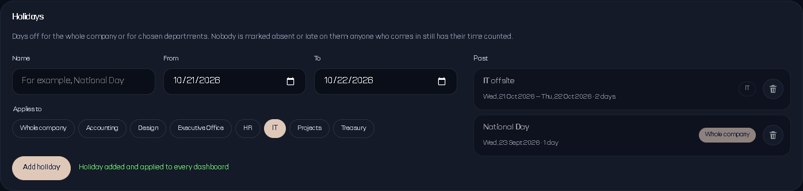

---

## System health

The top of Settings shows the state of every moving part, so a problem appears on the dashboard instead of only in the server logs. A red or yellow dot on the Settings tab means something needs attention, wherever you are in the dashboard.

| Group | Checks |
|---|---|
| **Jisr** | The key signs in · permission to read employees · permission to read attendance logs · background employee sync |
| **UniFi** | Developer API reachable (with the number of active users) · active users with no email, since their taps can't reach Jisr · door events still arriving (warns after 24 quiet hours) |
| **System** | Background worker running or paused · sending queue (held, failed, unconfirmed, waiting over an hour) · database size and event count · server uptime, memory and Node version |
| **Data** | HR employee list uploaded · people who tap in but are not on the list · brand files present |

- **Read-only.** The Jisr and UniFi checks only read data. They use their own Jisr sign-in, so they never disturb the worker.
- **Caching.** Results are cached for a minute; **Check now** runs them again straight away.
- **Status shapes.** Each status has an icon and a label, so colour is never the only signal.

The screenshot above comes from the demo, which points at addresses that don't exist on purpose, so Jisr and UniFi show as unreachable there.

---

## Accounts and roles

| Role | Can see |
|---|---|
| `admin` | Everything, including the event ledger, pause/retry and mapping emails |
| `hr` | Company, departments, employees and settings |

Accounts are managed from a terminal on the server (inside Docker: `docker exec -it unifi-jisr-attendance node dist/staff-cli.js ...`):

```bash
node dist/staff-cli.js list
node dist/staff-cli.js add <username> <admin|hr> "<Display Name>"   # prints a generated password once
node dist/staff-cli.js reset <username>                             # prints a new password once
node dist/staff-cli.js disable <username>
node dist/staff-cli.js enable <username>
```

Passwords are stored as hashes. Until the first staff account exists, `admin` can sign in with the bootstrap `DASHBOARD_PASSWORD`; that password stops working once staff accounts are created.

---

## The employee list

HR uploads the employee list as an Excel file from the Company page (**Upload list**). It gives the dashboard:

- Arabic and English names;
- titles, functions and departments;
- office numbers;
- work emails.

Only those fields are stored. Mobile numbers, dates of birth, nationality and parking are ignored. People missing from a new upload are marked inactive, not deleted. The list itself is never committed to this repository.

---

## Safety rules for punches

- **Hold rather than guess.** Anything ambiguous (no email, no single match, earlier than the last confirmed punch) is held for a person to resolve.
- **One writer.** A single worker sends punches in order. Run one instance only.
- **No double punches.** A failed send is reconciled against Jisr's attendance log before any retry.
- **Pause switch.** Admins can stop all sending from the event ledger at any time. The queue keeps filling and resumes in order.
- **Everything is kept.** Every UniFi delivery and every Jisr request and response is stored for audit.

---

## Running it

You need Node 22 or newer, for `node:sqlite`.

```bash
npm install
npm test              # vitest: in-memory SQLite and fake Jisr and UniFi; never calls the real services
npm run build         # builds the dashboard into public/, then compiles the server into dist/
npm start             # node dist/index.js on port 3000
```

While developing:

```bash
npm run dev:server    # API with live reload (tsx watch)
npm run dev           # Vite dev server for the dashboard
```

For a local copy that can't send real punches, point Jisr at an address that doesn't exist, for example `JISR_BASE_URL=http://127.0.0.1:9/api`.

To try the dashboard with history, fill a separate demo database with fictional people:

```bash
npx tsx scripts/seed-demo.ts ./demo/demo.sqlite 36 150   # the path must contain "demo"
```

The ZOOD logo and the ITF Huwiya font live in `brand/`. That folder is not in Git because the font is licensed; copy it next to the app or mount it in Docker. Without it, the dashboard falls back to system fonts and the health panel warns.

---

## Deploying on the Synology NAS

1. Copy the project, plus the `brand/` folder, to the NAS.
2. Build and start it:
   ```bash
   docker compose up -d --build
   ```
3. In UniFi Access, add a webhook to `http://<nas-ip>:3000/api/webhook/unifi`.
4. Create the staff accounts with `staff-cli`, sign in, and upload the employee list.
5. Open **Settings → System health** and check that every line is green.

Notes:

- **Data:** the database lives in `./data` on the NAS, mounted at `/app/data`. Back that folder up.
- **Brand files:** mount them with `./brand:/app/brand`.
- **Networking:** if the container can't reach the UniFi controller (for example, a different VLAN), use `network_mode: host` as described in `docker-compose.yml`.

---

## Configuration

Settings are read from environment variables, with defaults in `src/config.ts`.

| Variable | Default | Purpose |
|---|---|---|
| `PORT` | `3000` | HTTP port |
| `UNIFI_BASE_URL` | `https://192.168.8.1` | UniFi controller; the developer API is on port 12445 |
| `UNIFI_API_TOKEN` | | UniFi Access developer API token |
| `UNIFI_IGNORE_SSL` | `true` | Accept the controller's self-signed certificate |
| `JISR_BASE_URL` | `https://apis.jisr.net/api` | Jisr Open API |
| `JISR_SLUG` | `zood` | Company slug in Jisr |
| `JISR_API_KEY`, `JISR_API_SECRET` | | Jisr Open API key pair |
| `DASHBOARD_PASSWORD` | | Bootstrap admin password, used only before staff accounts exist |
| `WORK_START_MINUTES`, `LATE_GRACE_MINUTES`, `REQUIRED_MINUTES` | 540, 15, 480 | Starting work rules; Settings overrides them |

The Jisr key needs these Open API permissions: **Employees: read** and **Attendance logs: create and read**.

---

## API

| Method | Path | Who | Purpose |
|---|---|---|---|
| GET | `/health` | anyone | Liveness check for Docker |
| POST | `/api/webhook/unifi`, `/api/webhooks/unifi` | UniFi | Door events |
| POST | `/api/login`, `/api/logout` | staff | Session |
| GET | `/api/admin/me`, `/api/admin/staff` | staff | Current user, staff list |
| GET, POST | `/api/admin/directory`, `/api/admin/directory/import` | staff | Employee list |
| GET | `/api/admin/summary`, `/api/admin/analytics`, `/api/admin/contributions`, `/api/admin/people` | staff | Dashboard data |
| GET | `/api/admin/events`, `/api/admin/events/:id`, `/api/admin/employees` | admin | Event ledger |
| POST | `/api/admin/map`, `/api/admin/events/:id/retry`, `/api/admin/pause` | admin | Ledger actions |
| GET, PUT | `/api/admin/settings/rules` | staff | Work rules |
| GET, PUT | `/api/admin/settings/holidays` | staff | Holidays, company-wide or per department |
| GET | `/api/admin/health` (`?refresh=1`) | staff | System health |

---

## Project layout

```
src/
  index.ts         starts the server and the worker timer
  app.ts           HTTP routes (Hono)
  worker.ts        ordered sending and confirmation
  store.ts         SQLite ledger (node:sqlite)
  domain.ts        event rules and shared types
  normalize.ts     UniFi payload parsing
  unifi.ts         UniFi developer API client (email lookup, health probe)
  jisr.ts          Jisr Open API client (employees, punches, confirmation, health probe)
  attendance.ts    green / yellow / red day rules
  analytics.ts     company, department and employee figures
  rules.ts         work rules and holidays saved from Settings
  health.ts        system health checks
  directory.ts     HR Excel import
  staff.ts         accounts, passwords, sessions
  staff-cli.ts     account management from the terminal
client/
  main.tsx         app shell, navigation, search, language
  screens.tsx      every page
  charts.tsx       charts (rings, bars, heat maps, year grid, timelines)
  i18n.ts          all Arabic and English text
  app.css          ZOOD styles
scripts/seed-demo.ts   fictional demo data
docs/screenshots/      the images in this README
```

---

## Tests

```bash
npm test
```

There are 40 tests. They cover event classification and direction, ordering, duplicates, reconciliation, UniFi email lookup, staff accounts, the employee list import, attendance colours, company and department holidays, and the health checks. They use an in-memory database and fake Jisr and UniFi clients, so they never call the real services.

---

## Status and open items

- **Working and checked on real data:**
  - receiving UniFi events;
  - UniFi email lookup;
  - the dashboard;
  - work rules and holidays;
  - system health.
- **Waiting on Jisr permissions.** The current key signs in, but Jisr refuses to read employees and attendance logs (HTTP 403). Jisr IT needs to grant **Employees: read** and **Attendance logs: create and read**. Until then no punch can be sent or confirmed, and the end-to-end test can't run.
- **UniFi data to fix.** Some active UniFi users have no email, and some badge holders are not on the HR list. System health lists both.

---

Built for ZOOD. MIT licence (see `LICENSE`), except the ZOOD brand assets, which are not included.
